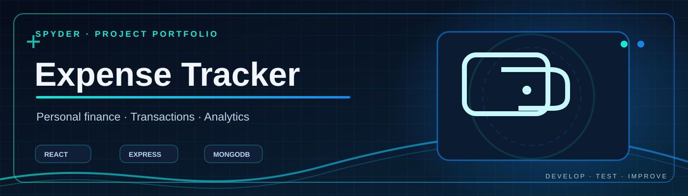

# Expense Tracker App

Full-stack JavaScript application for tracking financial transactions and viewing analytics, with a React frontend and an Express/MongoDB backend.

## Project layout

- `frontend/`: React application, components and pages.
- `backend/`: Express API, Mongoose models and authentication/transaction routes.

## Local development

Requirements: Node.js, npm and a MongoDB database.

1. In `backend/` install dependencies with `npm install`.
2. Create `backend/config/config.env` locally with `PORT=5000` and `MONGO_URL=<your MongoDB URI>`. Never commit it.
3. Run `npm run dev` from `backend/`.
4. In a second terminal, run `npm install` and then `npm start` from `frontend/`.
5. For local frontend API calls, configure `frontend/src/utils/ApiRequest.js` to point at your running backend. The current code includes a hosted API URL, which may no longer be available.

## Current implementation

- React frontend with login, register, avatar selection, home dashboard and analytics components.
- Express API using Mongoose for data persistence and bcrypt for password hashing.
- Transaction routes and React charts/components exist; production security and cross-environment behavior still require integration testing.

## Security and testing notes

- Never commit MongoDB connection strings or session credentials.
- Authentication and authorization checks need a dedicated security review before production deployment.
- An existing `App.test.js` contains a Create React App starter assertion and does not verify this application's features; do not interpret it as meaningful project coverage.
- Local end-to-end tests and a verified deployment build have not yet been completed in this audit.

## Maintainer

Abhinav Saini · GitHub: spyderabhi

## License

Refer to `LICENSE`.
